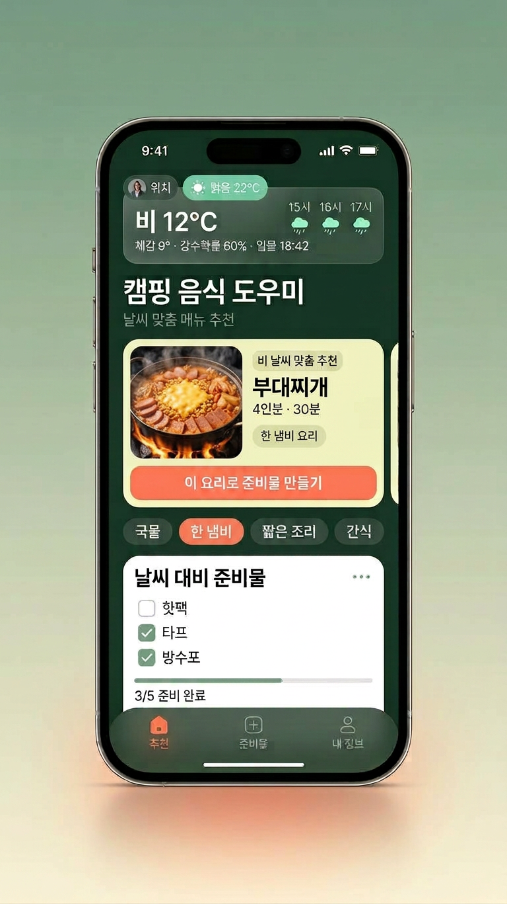
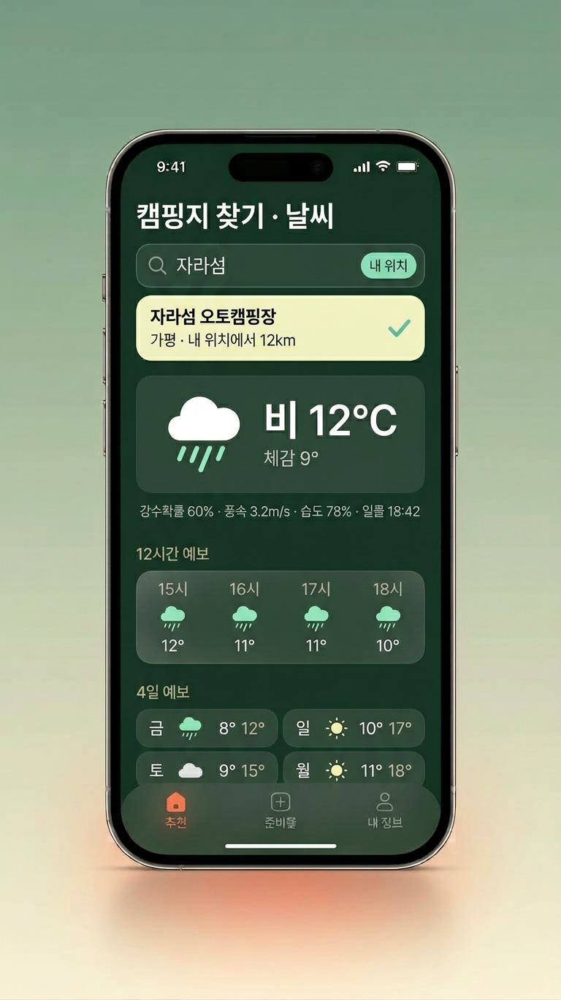
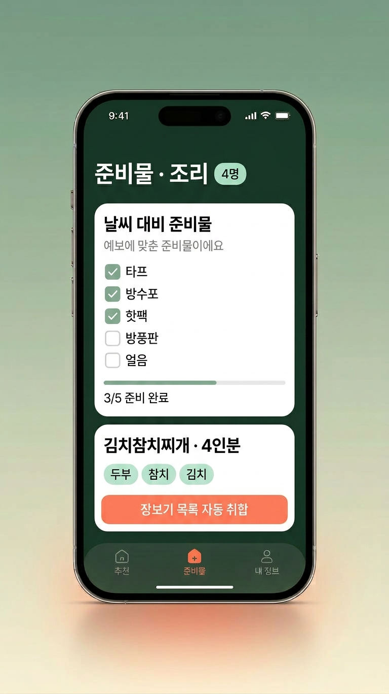
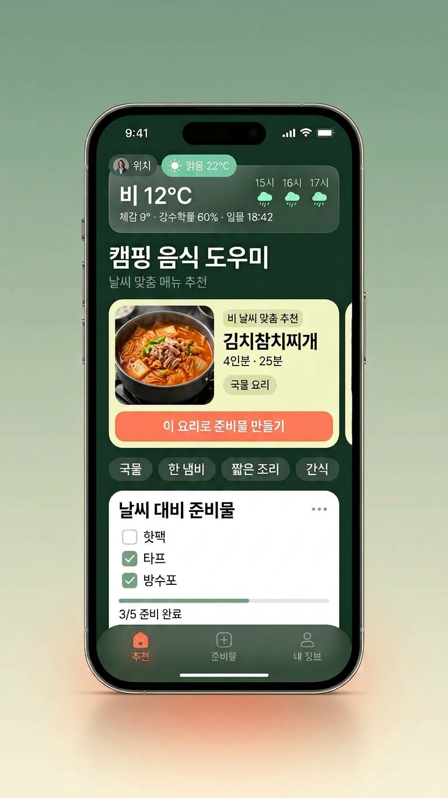
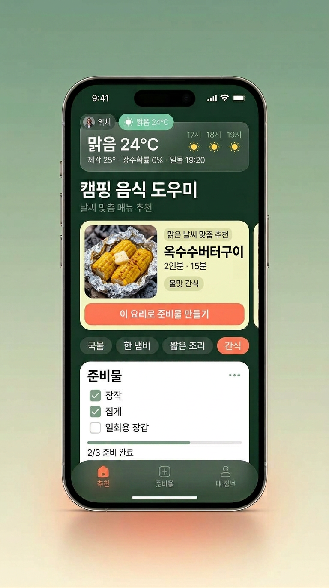

# 캠핑음식 도우미

나 혼자 쓰는 캠핑 요리 도우미 웹앱과 기획안입니다.

- **바로 접속 주소 (Vercel)**: https://camping-food-helper.vercel.app/
- `캠핑음식앱_기획안.md`: 개인용 앱 기획안 (v0.4)
- `camp-kitchen.html` / `index.html`: 1단계 웹앱 (인원·장비 입력 → 맞춤 메뉴 추천 → 준비물 체크리스트, 요리 직접 지정)

## UI 디자인 쇼케이스 (2026-10-16 추가)

화면 구성을 보여 주는 디자인 이미지입니다. 원본 6종은 `design/` 폴더에 있습니다(`ui-ux-showcase.png`는 영문 컨셉 원본).

**기능 흐름 시리즈** — 추천 → 캠핑지 날씨 → 준비물

| 추천 | 캠핑지 찾기 · 날씨 | 준비물 · 조리 |
|---|---|---|
|  |  |  |

**추천 화면 레시피 변형**

| 김치참치찌개 · 비 날씨 | 옥수수버터구이 · 맑은 날씨 |
|---|---|
|  |  |

## 캠핑지 날씨 · 인근 캠핑장 찾기 (2026-10-13 추가)

추천 탭의 **[캠핑지 찾기]** 카드에서 씁니다.

- **캠핑장 자동완성**: 이름·지역·초성(`ㅈㄹㅅ` → 자라섬)을 치면 캠핑장 후보를 제안합니다. [📍 내 위치]를 누르면 GPS 기준 반경 30km의 캠핑장을 **가까운 순서**로 보여주고, OpenStreetMap(실시간)에서 주변 야영지를 더 찾아 함께 붙여 줍니다. 목록에는 내 위치에서의 거리가 표시됩니다.
- **캠핑지 날씨**: 고른 캠핑지(또는 현재 위치)의 현재 기온·체감·강수확률·풍속·습도·일몰, 12시간 예보, 4일 예보를 가져옵니다. 키가 필요 없는 Open-Meteo를 씁니다.
- **날씨 맞춤 메뉴 자동 제안**: 비·눈·추위·쌀쌀·강풍·무더위·더위·좋음 8가지로 분류해 국물/한 냄비/짧은 조리 메뉴를 골라 줍니다. 메뉴를 누르면 준비물 목록까지 만들어지고, AI 추천·준비물 프롬프트에도 캠핑지와 날씨가 함께 들어갑니다(내 정보 탭에서 끌 수 있어요).
- **날씨 대비 준비물**: 타프·방수포·핫팩·방풍판·얼음 등을 체크리스트에 한 번에 추가합니다.
- **인터넷·위치가 막혀도**: [지금 날씨를 직접 고르기]로 조건만 골라 같은 맞춤 메뉴를 쓸 수 있고, 준비물 탭에는 저장된 예보가 남습니다.
- **접기·펼치기 기준**: 추천 탭의 [캠핑지 찾기]·[쿨러백 털기] 카드는 처음에 접혀 있어요. [캠핑지 찾기] 제목 영역이나 [열기 ▼]/[접기 ▲] 버튼으로만 캠핑지 카드 본문을 토글하고, [전국 4,000+ 탐색 →]은 캠핑장 탐색 탭으로 이동합니다. 접힌 상태에는 제목과 선택한 캠핑지/접힘 안내만 남고 검색·GPS·직접 날씨 선택은 숨겨집니다. 캠핑지를 직접 고르면 카드는 자동으로 펼쳐집니다.
- **캠핑지 날씨 카드**: 추천 탭의 [캠핑지 날씨]도 처음에는 접혀 있어요. 접힌 상태에는 캠핑지·현재 기온·날씨·강수확률 한 줄 요약만 보이고, [캠핑지 날씨] 제목 영역이나 [열기 ▼]/[접기 ▲] 버튼으로 예보·날씨 맞춤 메뉴를 펼치거나 접습니다. 캠핑지를 골라도 이 카드는 자동으로 펼쳐지지 않아요.

### 데이터 출처

| 쓰임 | 자료 | 비고 |
|---|---|---|
| 캠핑장 이름·좌표 4,018곳 (`data/campgrounds.js`) | 한국관광공사 **고캠핑** 정보 (공공데이터포털) | 2024-09 스냅샷, `이름\|시군구\|시도코드\|위도,경도\|시설코드` 형식으로 압축 |
| 날씨 예보·지역 검색 | Open-Meteo | API 키 필요 없음 |
| 주변 야영지 실시간 보강 | OpenStreetMap Overpass API | 12시간 캐시, 실패해도 번들 데이터로 동작 |

`index.html`을 파일로 직접 열 때도 `data/campgrounds.js`가 같은 폴더에 있으면 자동완성이 동작합니다(없으면 실시간 검색과 직접 입력만 가능).

## 선택한 캠핑장 소개 (2026-10-16 추가)

추천 탭 **[캠핑지 찾기]**에서 캠핑지를 고르면 **선택한 캠핑장 소개 카드**가 바로 아래에 나타납니다. 캠핑장 탐색 탭의 [날씨·상세 ☀️] 모달에도 같은 소개가 요약으로 들어갑니다.

- **데이터 요약 소개**: 이름·지역·시설 구분(일반야영장/자동차야영장/글램핑/카라반/캠프닉)·내 위치에서의 거리·차로 걸리는 대략 시간·반경 25km 안의 다른 캠핑장 수를 묶어 소개합니다. 여기에 하이라이트 3~4개, 어울리는 캠핑 스타일, 이 캠핑지에서 먹기 좋은 메뉴 3개, 가기 전 확인할 것, 현장 팁을 함께 보여 줍니다. 날씨를 불러온 캠핑지라면 오늘 날씨에 맞춘 팁으로 바뀌고 추천 메뉴도 날씨 기준으로 바뀝니다.
- **AI 소개**: 서버에 `GEMINI_API_KEY`가 있으면 같은 정보를 AI가 한 번 다듬어 줍니다(카드 배지가 `📊 데이터 요약` → `✨ AI 소개`). AI가 없거나 신호가 약해도 데이터 요약 소개는 그대로 쓸 수 있고, 결과는 캠핑지별로 저장해 다시 열 때 재사용합니다(`cc.campIntro`, 최대 12곳).
- **지어내지 않기**: 공공데이터에는 편의시설·요금·예약 정보가 없어서 샤워장·전기·매점·반려견 동반·요금은 단정하지 않고 "[확인 필요]"로 안내합니다. 이름에 들어 있는 고유명사만으로 실제 경관을 단정하지 말라는 규칙도 프롬프트에 넣어 두었습니다.
- **바로 이어지는 행동**: 추천 메뉴를 누르면 준비물 목록이 만들어지고, [📋 소개 복사]로 카톡 공유용 텍스트를 복사합니다. [🌤️ 날씨·상세 보기]·[🧭 길찾기]로 상세 모달·지도로 이어집니다.
- **추천에도 반영**: 캠핑지가 정해져 있으면 AI 메뉴 추천·준비물 프롬프트에 캠핑지 이름·시설 구분과 특징 한 줄이 함께 들어갑니다.
- **GPS 현재 위치**: GPS로 잡은 현재 위치는 캠핑장 이름이 아니라서 AI 소개를 만들지 않고, 주변 캠핑장·날씨 기준 안내만 보여 줍니다.
- **호출을 아끼는 기준**: 추천 탭 소개 카드는 캠핑지를 고를 때만 AI를 한 번 호출하고(이미 받아 둔 캠핑지면 호출 없음), 탐색 탭 상세 모달은 [✨ AI 소개 받기]를 누를 때만 호출합니다.

### 함께 고친 것 (2026-10-16)

- 상세 모달의 닫는 `</div>` 하나가 문자열 연결에서 빠져 있던 문제(`'</div>';+` → `'</div>'+`)를 고쳤습니다.
- 모달 내용에 걸려 있던 `onclick="event.stopPropagation()"` 때문에 내용 안의 ✕·취소 버튼이 눌러도 동작하지 않던 문제를 고쳤습니다. 이제 바깥(백드롭)을 누르면 닫히고, 내용 안쪽을 누르면 닫히지 않습니다.

## 첫 화면 · 추천 카드 개선 (2026-10-16)

추천 탭의 첫 화면 구성과 추천 카드 비교를 정리했습니다.

- **첫 화면 정리**: 인원·장비·끼니 선택 카드를 캠핑지 찾기·캠핑장 소개·날씨·쿨러백 털기 등 부가 기능보다 위에 배치했습니다. 추천 결과와 [만들 요리가 정해져 있다면] 바로 아래에 부가 기능 카드가 이어집니다.
- **입력 간소화**: 끼니는 바로 고르고, 스타일·조리 시간·원하는 분위기는 **[세부 조건 설정]** 접이 영역에 접어 표시합니다(기본 접힘). 접힌 상태에는 현재 선택을 한 줄 요약으로 보여 줍니다.
- **주요 버튼 명확화**: 추천 요청 버튼 문구를 **[이 조건으로 메뉴 추천받기]**로 바꿨습니다.
- **추천 카드 비교 개선**: 모든 추천 카드가 `⏱️ 예상 조리시간`·`📊 난이도`·`추천 이유`를 같은 라벨·형식으로 보여 줍니다. 값이 없으면 `미정`으로 표시해 카드끼리 비교하기 쉽게 했습니다.
- **모바일 제목 개선**: 480px 이하에서 제목 글자 크기를 화면 폭에 맞춰 줄이고 단어 중간 줄바꿈을 막았으며, 배경 그림(씬) 투명도를 낮춰 글자 읽기를 방해하지 않게 했습니다.

### 첫 화면·추천 카드 자동 테스트 (`scripts/test-ui.mjs`)

위 변경이 회귀하지 않는지 확인하는 `node:test` 기반 테스트 4개를 추가했습니다. 로컬 실행은 `npm test`, CI와 Firebase 배포 워크플로에서도 함께 돌립니다.

1. 첫 화면: 인원·장비·끼니 선택이 캠핑장 등 부가 기능보다 위에 배치
2. 입력 간소화: 스타일·조리시간·분위기가 기본 접힌 [세부 조건 설정]에 존재
3. 추천 카드: 예상 조리시간·난이도·추천 이유 라벨 통일
4. 모바일 제목: 글자 크기·줄바꿈·배경 그림 간섭 완화 스타일과 `index.html`/`camp-kitchen.html` 동기화

> 실제 모바일 브라우저에서의 화면·터치 동작 확인은 후속 검증으로 남겨 두었습니다. 오프라인 지원, 재료 합산 로직 개선도 후속 작업 범위입니다.

## 자동화 · 품질 검증

푸시와 PR마다 GitHub Actions가 검사를 돌리고, Vercel 배포는 `main` 머지 시 자동으로 실행됩니다. Firebase Hosting 배포·재실행 방법은 아래 배포 절을 참고하세요.

### CI (`.github/workflows/ci.yml`)

| 잡 | 검사 내용 | 로컬 실행 |
|---|---|---|
| 백엔드 문법 검사 | `server.js`, `api/`, `lib/`, `scripts/` 문법 (`node --check`) | `node --check server.js` |
| 클라이언트 정적 스캔 | `index.html`, `camp-kitchen.html`, `data/*.js`에서 `process.env`, `require(`, `module.exports`, `__dirname` 같은 서버 전용 참조 검출. 주석은 무시합니다. | `npm run check:client` |
| HTML 유효성 | `html-validate`로 구조 오류 검사 | `npx html-validate@8.29.0 index.html camp-kitchen.html` |
| 자동 테스트 | UI 회귀 테스트 4개 + Firebase 배포 설정·워크플로 회귀 테스트 | `npm test` |
| 의존성 취약점 | `npm audit --omit=dev --audit-level=high` (high 이상이면 실패) | — |

- 클라이언트 코드는 브라우저에 `process`가 없습니다. `process.env`를 쓰면 앱 전체가 멈추므로, 키 유무는 서버가 판단해서 503으로 알려주도록 되어 있습니다.
- `index.html`과 `camp-kitchen.html`은 같은 내용입니다. 한쪽을 고치면 다른 쪽도 같이 고치세요.

### 의존성 자동 업데이트 (`.github/dependabot.yml`)

- 매주 월요일 오전 9시(KST)에 npm 패키지와 GitHub Actions 버전을 점검해 PR을 만듭니다.
- 마이너·패치 업데이트는 한 PR로 묶고, 메이저 업데이트는 자동 PR에서 제외합니다(예: express 5.x). 보안 경고는 별도로 올라옵니다.

### 배포 (Firebase Hosting GitHub Actions CI/CD & Vercel)

- **Firebase Hosting 자동 배포 (`.github/workflows/firebase-deploy.yml`)**:
  - `main` 브랜치에 푸시(또는 PR 머지)되면 **백엔드·스크립트 문법 검사 → 클라이언트 보안 스캔 → 자동 테스트 → HTML 유효성 검사 → 정적 번들(`dist/`) 빌드 → Firebase 설정 검증**을 거친 뒤 **Firebase Hosting(`live` 채널)**에 자동으로 배포됩니다.
  - 같은 저장소의 일반 Pull Request는 자격 증명이 있을 때 임시 프리뷰 채널(7일 유지)에 배포하고 PR 코멘트로 미리보기 URL을 남깁니다. fork·Dependabot PR은 품질 검사와 빌드만 수행합니다.
  - 배포 대상은 **`FIREBASE_PROJECT_ID` 시크릿 → 미설정 시 서비스 계정 JSON의 `project_id`** 순서로 선택하며, 검증한 값을 live·PR 배포 액션 양쪽에 명시적으로 전달합니다.
  - `main` 배포에 필요한 서비스 계정 시크릿이 없거나 설정 형식이 잘못되면 실패합니다. 일반 PR에서 시크릿이 없으면 경고와 함께 배포를 건너뜁니다. **검증만 성공한 실행과 실제 배포 성공은 다릅니다**(Actions 실행 요약 참고).
  - 빌드 단계(`npm run build:hosting`)에서 `dist/` 폴더에 클라이언트 필수 자산(`index.html`, `camp-kitchen.html`, `data/campgrounds.js`, 비밀번호·비공개 상세주소가 마스킹된 `data/secret_gardens.json`)만 추출하여 서버 전용 코드나 민감 정보가 정적 호스팅에 노출되지 않도록 보호합니다.

**Firebase Hosting 자동 배포 초기 설정 (GitHub Secrets 1회 등록)**

1. **Firebase 프로젝트 준비**: [Firebase 콘솔](https://console.firebase.google.com/)에서 프로젝트를 생성하거나 기존 프로젝트 ID를 확인합니다. GitHub Actions는 등록된 서비스 계정의 프로젝트를 기본 배포 대상으로 사용합니다. `.firebaserc`의 `camping-food-helper`는 로컬 CLI용 기본값이므로, 로컬에서 직접 배포한다면 실제 프로젝트에 맞추거나 `--project`를 지정하세요.
2. **서비스 계정 키 발급 (권장 방법 A - CLI 자동 설정)**:
   로컬 터미널에서 프로젝트 루트 폴더로 이동한 뒤 아래 명령어를 실행하면 GitHub 인증과 서비스 계정 생성·시크릿 등록이 한 번에 완료됩니다.
   ```bash
   npx firebase-tools login
   npx firebase-tools init hosting:github
   ```
3. **서비스 계정 키 수동 등록 (방법 B - 콘솔에서 직접 등록)**:
   - Firebase 콘솔 → **프로젝트 설정(⚙️) → 서비스 계정 → 새 비공개 키 생성**으로 JSON 파일을 다운로드합니다(또는 Google Cloud IAM에서 `Firebase Hosting Admin` 권한이 부여된 서비스 계정 JSON 키 발급).
   - GitHub 저장소 **Settings → Secrets and variables → Actions → New repository secret**에서 아래 시크릿을 추가합니다:
     - `FIREBASE_SERVICE_ACCOUNT`: 다운로드한 서비스 계정 JSON 파일의 전체 내용 붙여넣기 (필수)
     - `FIREBASE_PROJECT_ID`: 배포할 Firebase 프로젝트 **ID** (표시 이름·프로젝트 번호가 아님). 선택 사항이며, 미설정 시 `FIREBASE_SERVICE_ACCOUNT` JSON의 `project_id`를 사용합니다. 서비스 계정 소속과 다른 프로젝트로 배포하려면 이 값을 명시하고 대상 프로젝트의 IAM 권한을 부여하세요.

#### Firebase 배포 문제 해결 (2026-10-16)

`FIREBASE_PROJECT_ID`를 안내만 하고 배포 액션에 전달하지 않던 누락을 수정했습니다. 별도 프로젝트 ID가 없으면 저장소의 예시 프로젝트 이름 대신 **서비스 계정과 같은 프로젝트**로 배포합니다. 또한 `scripts/check-firebase-config.mjs`(`npm run check:firebase`)로 JSON 형식, 서비스 계정 필수 필드, RSA 비공개 키, 배포 대상 ID를 먼저 확인합니다. 키 원문·이메일은 로그/요약에 기록하지 않습니다. 계정 소속과 배포 대상 프로젝트가 다르면 경고하되, 대상 프로젝트에 권한을 부여한 교차 프로젝트 배포는 허용합니다.

이 검사는 **설정 형식만** 확인합니다. 키의 실제 유효성·IAM 권한·Firebase/Hosting 활성화 여부는 배포 단계에서 확인해야 합니다. 설정 검사에 통과했다는 이유만으로 배포 문제가 해결됐다고 판단하지 마세요.

1. **실패 단계 확인**: Actions → **Deploy to Firebase Hosting** → 실패한 실행을 열어 설정 검사 실패인지 실제 배포 실패인지 구분합니다. `npx ... exit code 2`만으로 원인을 단정하지 말고, 실패한 배포 단계에 나온 첫 Firebase 오류를 확인합니다.
2. **프로젝트 없음/권한 거부**: `FIREBASE_PROJECT_ID`가 정확한지, 서비스 계정에 **배포 대상 프로젝트**의 `Firebase Hosting Admin` 권한이 있는지 확인합니다. 계정 소속 프로젝트의 권한만으로 다른 프로젝트에 배포할 수는 없습니다.
3. **인증 오류**: 서비스 계정 키가 삭제·비활성화되지 않았는지 확인하고, 필요하면 새 키를 발급해 GitHub Secret을 교체합니다. JSON 일부, 파일 경로, API 키를 서비스 계정 JSON 대신 넣으면 안 됩니다. **키 원문을 채팅·PR·이슈에 붙여 넣지 마세요.**
4. **Hosting 사이트 없음**: Firebase 콘솔에서 대상 프로젝트와 기본 Hosting 사이트가 준비되어 있는지 확인합니다. 다른 사이트/멀티사이트를 사용한다면 별도의 Hosting 대상 설정이 필요합니다.
5. **수정 후 재실행**: 코드 변경은 새 PR의 프리뷰 배포로 확인하고, 머지 후 `main`의 live 배포 결과를 확인합니다. 시크릿만 바꿨다면 최신 `main` 워크플로의 **Run workflow**를 사용합니다. 이전 커밋의 실행을 재실행하면 예전 워크플로가 실행되므로 코드 수정 확인에는 적합하지 않습니다. `main` 이외 브랜치의 수동 실행은 빌드·검사만 하고 live에는 배포하지 않습니다.

회귀 테스트(`scripts/test-firebase-config.mjs`)는 임시 테스트 키만 사용해 프로젝트 선택 우선순위, 잘못된 자격 증명, 비밀정보 미출력, 배포 생략/실패 구분, 워크플로 연결·브랜치 제한을 검사합니다. `npm test`에 포함되어 CI와 배포 워크플로에서 함께 실행됩니다.

> Firebase Hosting은 현재 **정적 프런트엔드만** 배포합니다. Express/Vercel의 `/api/*` 서버 기능은 이 번들에 포함되지 않으며, Firebase에서 AI 등 서버 기능까지 제공하려면 별도 백엔드 연결이 필요합니다. 이번 수정은 Hosting 배포 설정 범위입니다.

- **Vercel 병행 배포**: `main`에 머지되면 Vercel GitOps 연동 환경에서도 함께 자동 배포됩니다.

### 헬스체크 (`.github/workflows/uptime-check.yml`)

10분마다 아래 대상을 점검하고, 실패하면 텔레그램으로 알립니다.

| 대상 | 정상 기준 |
|---|---|
| https://camping-food-helper.vercel.app/ | HTTP 200 |
| `POST /api/sample`, `POST /api/generate-image` | 빈 요청에 HTTP 400 (프롬프트 없음 → Gemini를 호출하지 않아 쿼터를 쓰지 않음) |
| Open-Meteo 날씨 API | HTTP 200 + 현재 기온 값 존재 |

- 응답이 5초를 넘거나 연결이 실패하면 장애로 봅니다. 한 번 더 확인한 뒤에도 실패해야 알림을 보냅니다.
- 실패한 실행은 GitHub Actions 실패 메일도 보냅니다.

**텔레그램 알림 설정 (한 번만)**

1. 텔레그램에서 `@BotFather`로 봇을 만들고 토큰을 받습니다.
2. 만든 봇에게 아무 메시지나 보낸 뒤 `https://api.telegram.org/bot<토큰>/getUpdates`에서 `chat.id` 값을 확인합니다.
3. GitHub 저장소 **Settings → Secrets and variables → Actions**에 `TELEGRAM_BOT_TOKEN`, `TELEGRAM_CHAT_ID`를 추가합니다.

시크릿이 없으면 점검은 계속 돌고 알림만 건너뜁니다.

## 참고

- 웹앱의 AI 추천 기능은 Claude의 아티팩트 환경에서만 동작합니다. 이 저장소의 파일을 다른 곳에서 열면 화면은 보이지만 추천 버튼은 쓸 수 없습니다.
- 이 저장소는 백업과 버전 기록용입니다. 실제로 쓰는 앱은 Claude에 게시된 아티팩트입니다.
